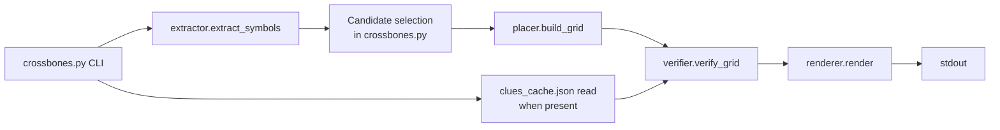

# Design Document — crossbones-cli

## Overview

Crossbones turns a Python codebase into a crossword that teaches the code. The CLI is `python crossbones.py <repo_path>`. The pipeline is: extract symbols (existing `extractor.py`), select candidates, greedily place answers into a grid over 50 shuffled attempts, verify every entry against the extracted symbols, and print the grid with numbered across/down entries and `file:line` origins.

This feature adds four modules at the repository root: `crossbones.py` (CLI), `placer.py`, `verifier.py`, and `renderer.py`. `extractor.py` is consumed as-is, never modified. Clue generation, HTML output, difficulty levels, and non-Python languages are out of scope; `clues_cache.json` is only read when present.

## Architecture



Data flows one direction: extract → select → place → verify → render. The CLI orchestrates; each stage is a plain module of functions (no classes beyond a small `Entry` dataclass). Errors in verification are collected, reported, and the output still prints (Requirement 4.6).

## Components and Interfaces

### crossbones.py (CLI entry point)

```
main(argv) -> int
select_candidates(symbols, limit=25) -> list[dict]     # candidate selection
```

- Parses `argv[1]` as `repo_path`. Missing/non-directory/no-arg → usage message on stderr, non-zero exit.
- Calls `extract_symbols(repo_path)`. Empty result → "no symbols found" message, exit 0.
- Selects candidates: filter to symbols whose `answer` is alphabetic 4–15 letters (already guaranteed by `normalize`, but re-checked defensively), prefer docstring symbols, drop duplicate answers, sort by answer length descending, cap at 25.
- Runs `placer.build_grid(candidates)`.
- Loads `clues_cache.json` if present (`json.load`, keyed by answer).
- Runs `verifier.verify_grid(grid, entries, symbols, clues)`.
- Prints verifier failures (if any), then `renderer.render(grid, entries)`.
- Exits 0 in the success and no-symbols cases; non-zero only for bad usage or unexpected exceptions.

Candidate preference rule (Req 2.1): symbols with a non-empty `doc` are preferred. Sort key: `(doc present desc, answer length desc)`. Duplicates are dropped by answer string.

### placer.py

```
build_grid(candidates, attempts=50, seed=None) -> (grid, entries)
place_first(grid, entries, candidate) -> None
try_place(grid, entries, candidate) -> bool
can_place(grid, entries, word, row, col, direction) -> bool
causes_collision(...) / causes_adjacency(...) -> bool
```

- `grid` is a `dict[(row, col) -> letter]` (sparse), not a list-of-lists, so the grid can grow in any direction without resizing. Bounding box is computed only at render time.
- `entries` is a list of `Entry` objects.
- Deterministic when `seed` is given (used by tests); the CLI passes no seed so each run varies.

### verifier.py

```
verify_grid(grid, entries, symbols, clues) -> list[Failure]
```

- `symbols` is the set (or dict) of answers from `extract_symbols`.
- `clues` is the dict from `clues_cache.json` or `{}`; a docstring clue is derived as a fallback when the symbol has a `doc`.
- Returns a list of `Failure` records: `(entry, check_name, detail)`. Empty list means all entries passed.

### renderer.py

```
render(grid, entries) -> str
number_entries(entries) -> dict[(row, col) -> number]
```

- `number_entries` implements standard crossword numbering: scan bounding-box cells in row-major order; a cell starts an across entry if no across entry occupies the cell immediately to its left, and starts a down entry if no down entry occupies the cell immediately above. Both directions starting in the same cell share one number.
- `render` returns the full output string: the grid block, then an across list, then a down list. The CLI prints it.

## Data Models

### Entry (dataclass, in `placer.py`)

```python
@dataclass
class Entry:
    answer: str      # uppercase word, e.g. "PARSECONFIG"
    name: str        # original symbol name, e.g. "parse_config"
    kind: str        # "function" | "class" | "file"
    file: str        # repo-relative path
    line: int
    direction: str   # "across" | "down"
    row: int
    col: int
```

Length is `len(answer)`. The Answer→`file:line` map (Req 5.5) is derived directly: `origin = f"{e.file}:{e.line}"` per entry; the CLI keeps `{e.answer: origin}` for placed entries (deduplicated by answer).

### Grid

Sparse dict `{(row, col): letter}`. A cell is empty iff the key is absent. All placement checks read this dict; only successful placements mutate it.

### Failure (named tuple, in `verifier.py`)

```python
Failure = namedtuple("Failure", "entry check detail")
# check is one of: "symbol", "grid-word", "clue-containment", "crossing"
```

## Placement Algorithm (Greedy Intersection Search)

One **attempt**:

1. Shuffle the candidate list (random order).
2. Place the first candidate horizontally at `(0, 0)`, across, unconditionally (empty grid, Req 3.1).
3. For each subsequent candidate, enumerate all legal placements that cross an existing entry:
   - For each existing entry and each index `i` in the new word, for each letter-position `j` in the existing entry where `new_word[i] == existing_word[j]`: compute the new entry's start so the new letter lands on the existing entry's cell.
   - The new entry runs perpendicular to the existing one (cross an across entry with a down placement, and vice versa) — this guarantees a genuine intersection rather than mere touching.
4. For each computed (row, col, direction), test `can_place`:
   - **Collision check**: every existing letter that overlaps a required cell must equal the required letter (Req 3.4).
   - **Adjacency check** (Req 3.5): for each cell of the new word *except* the intersection cell, the cells perpendicular to the new word's direction must be empty (this prevents parallel side-touching words). Additionally, the cell immediately before the word's start and immediately after its end, along its direction, must be empty (prevents head/tail abutment).
   - The intersection cell itself is exempt from the perpendicular-empty rule — it is exactly where the entries meet.
5. First placement that passes both checks is committed (word letters written into grid, `Entry` appended). If none passes, the candidate is dropped for this attempt (Req 3.3).
6. **Density** = `len(entries)`; tie-break = filled-cell count (Req 3.6).

Run 50 attempts (Req 3.7); keep the best `(entries, grid)` pair. First attempt in tests may use `attempts=1, seed=fixed` for determinism.

## Verification Logic

Four checks per entry, in order; all applicable checks run and all failures are reported (an entry can fail more than one):

1. **symbol**: `entry.answer in symbols_set` (the answer set derived from `extract_symbols` output). Fail → check `"symbol"`.
2. **grid-word**: read `len(answer)` cells from the grid along the entry's direction from `(row, col)`; the joined string must equal `answer`. Fail → `"grid-word"`.
3. **clue-containment** (skipped when no clue exists, Req 4.7): the clue for the entry comes from `clues_cache.json[answer]` if present, else the symbol's `doc` if non-empty. If the answer (case-insensitively) appears in the clue text, fail → `"clue-containment"`. Containment is plain substring matching, case-insensitive, on the answer as a whole word boundary-free substring (simple `answer.lower() in clue.lower()`).
4. **crossing**: for each grid cell of the entry that is shared with another entry (any other entry covering that cell), the letters must agree. Since the grid stores one letter per cell, this check validates that no entry *requires* a different letter at a shared cell — implemented by recomputing each overlapping entry's letter at the shared position from its own answer and comparing. Fail → `"crossing"`.

The CLI prints, for each failure, the answer, the entry's origin, and the failed check name, then prints the rendered output regardless (Req 4.6).

## Terminal Rendering

- Compute the bounding box of all grid cells; render that rectangle. Filled cells show the letter; empty cells show a distinctive character — `·` (middle dot), with `#` as fallback if the terminal is not UTF-8 (detected via `sys.stdout.encoding`). Cell separator: one space between columns, one blank line between rows.
- Numbering (Req 5.2): row-major scan of the bounding box. A cell gets a number if an across entry starts there, or a down entry starts there, or both; shared start cell → shared number. Numbers are printed in the grid as a small superscript-like prefix (rendered as `[n]` before the cell letter on the first cell of each entry) and used in the clue lists.
- After the grid, print:

```
ACROSS
  1. PARSECONFIG  (extractor.py:14)
  2. ...

DOWN
  1. ...
```

Each line: number, answer, and the `file:line` origin from the answer map (Req 5.4, 5.5).

## Error Handling

- **Bad usage** (missing arg, non-directory): usage message to stderr, exit non-zero. This mirrors `extractor.py`'s existing behavior.
- **No usable symbols**: message, exit 0 (Req 1.4).
- **Unreadable/undecodable `.py` files**: `extract_symbols` already skips them; nothing added here.
- **`clues_cache.json` missing or malformed**: treated as `{}`; verification skips clue checks. Malformed JSON is caught (`json.JSONDecodeError`) and warned on stderr, not fatal.
- **Placement produces zero entries** (can happen with pathological candidate sets): print the no-symbols-style message and exit 0.
- **Verification failures**: reported per-entry with the failed check name; rendering continues (Req 4.6). Verification failures do not change the exit status, because the crossword is still printed and usable.

## Testing Strategy

> **Note on property-based testing:** The repository rules mandate the standard library only, and the requirements document explicitly specifies plain `unittest` example-based tests with no third-party libraries (no hypothesis). Property-based testing with a PBT library is therefore not applicable to this feature. The correctness invariants P1, P4, and P5 from the requirements are instead validated with deterministic example-based tests, as detailed below.

Tests live in `tests/` and use `unittest` only. They run with `python -m unittest discover tests`. No mocks beyond standard `unittest.mock` where needed (e.g., patching `sys.argv` for CLI tests).

### P1: Grid legality (invariant, example-based)

Test that for grids produced by the placer, every entry's cells spell its answer, cells hold one letter, crossings agree, and no illegal adjacency exists.

- `test_p1_first_word_placed`: `build_grid` with one candidate returns one entry; grid cells spell the answer.
- `test_p1_crossing_entries_agree`: two candidates sharing a letter produce a grid where both entries' letters agree at the shared cell (check directly).
- `test_p1_no_collision_or_adjacency`: after placing several candidates, scan every entry's cells; assert every grid cell covered by two entries shows the same letter to both, and no two parallel entries touch side-by-side (assert via adjacency check on the final grid).
- `test_p1_dropped_candidates_absent`: a candidate that cannot legally cross any placed entry is absent from the final entries list.

### P4: Verification detection (error conditions)

- `test_p4_symbol_check`: an entry whose answer is not in the symbol set fails with check `"symbol"`.
- `test_p4_grid_word_check`: construct a grid whose letters differ from the entry's answer; fails with `"grid-word"`.
- `test_p4_clue_containment`: a clue containing the answer fails `"clue-containment"`; a clue without it passes.
- `test_p4_crossing`: two entries whose required letters differ at a shared cell fail `"crossing"`.
- `test_p4_no_clue_skipped`: an entry with no clue available produces no `"clue-containment"` failure.

### P5: Verification acceptance (round trip)

- `test_p5_placer_output_accepted`: run the full pipeline on a fixture repo (a `tests/fixtures/` directory with a few small `.py` files containing functions and classes with docstrings); the verifier returns no failures.
- `test_p5_cli_end_to_end`: invoke `crossbones.main` via `unittest.mock` patched `sys.argv` against the fixture repo; capture stdout; assert exit code 0, the grid block appears, and each printed entry line carries a `file:line` origin.

### Additional unit tests

- Candidate selection: docstring preference, 25-cap, longest-first sort, duplicate drop, 4–15 letter filter.
- Renderer: numbering scheme (shared start cell → shared number; row-major order), empty-cell distinctness, across/down lists contain all entries.
- CLI usage errors: no args and non-directory path → non-zero exit, usage on stderr; empty repo → exit 0 with message.

All tests are deterministic (placer seeded in unit tests). Tests are written and must pass before the feature task is considered complete.
